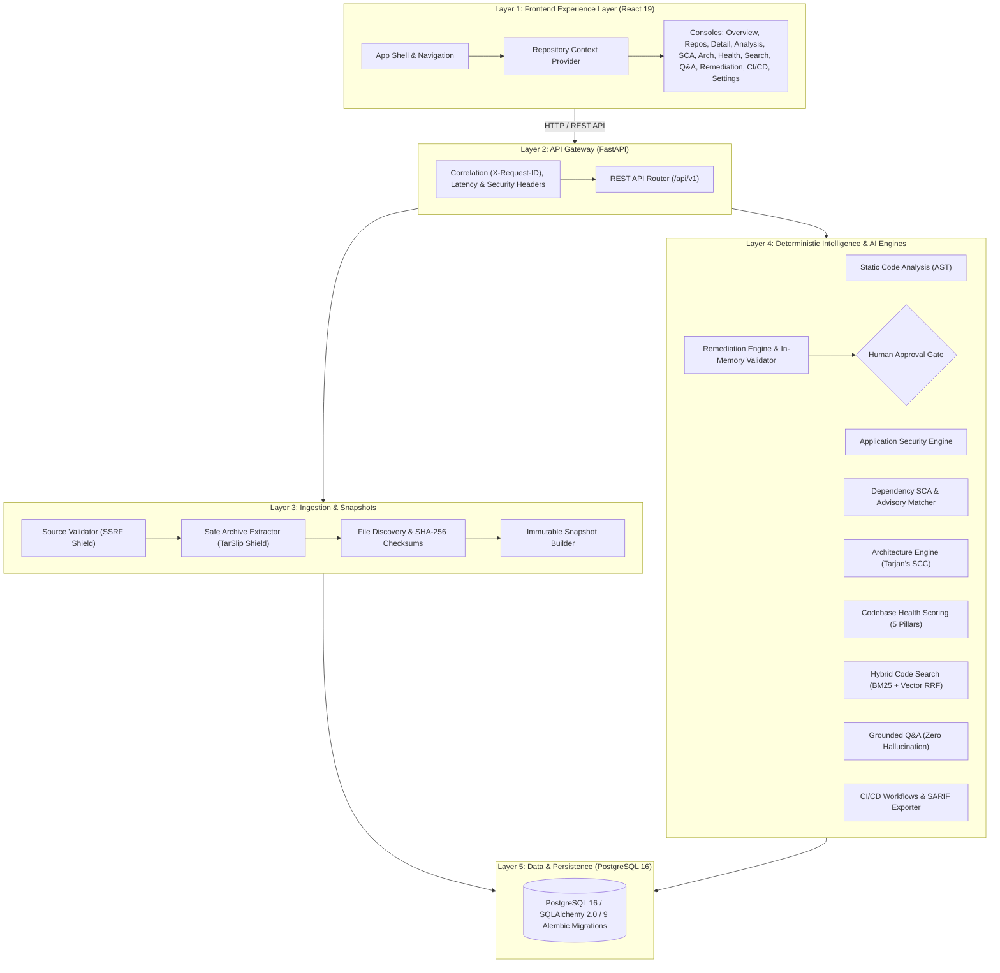

# CodeSentinel AI

> **AI-Powered Software Engineering Intelligence Platform & Local-First Codebase Governance**

[](https://www.python.org/)
[](https://fastapi.tiangolo.com/)
[](https://react.dev/)
[](https://www.typescriptlang.org/)
[](https://www.postgresql.org/)
[](https://tailwindcss.com/)
[](docker-compose.yml)
[](#testing--verification)
[](#testing--verification)

---

## Table of Contents

- [Overview](#overview)
- [The Problem We Solve](#the-problem-we-solve)
- [Key Capabilities](#key-capabilities)
- [System Architecture](#system-architecture)
- [Technology Stack](#technology-stack)
- [Installation & Local Setup](#installation--local-setup)
- [Docker Quick Start](#docker-quick-start)
- [Step-by-Step Usage Guide](#step-by-step-usage-guide)
- [Testing & Verification](#testing--verification)
- [Security Model & Invariants](#security-model--invariants)
- [Known Limitations](#known-limitations)
- [Future Roadmap](#future-roadmap)
- [License & Contribution](#license--contribution)

---

## Overview

**CodeSentinel AI** is an engineering intelligence and codebase governance platform that helps software engineers, security leads, and technical architects understand, audit, secure, and safely improve their software repositories.

Unlike generic "AI coding wrappers" that blindly pipe raw code into cloud LLMs and frequently hallucinate non-existent CVEs, deprecated APIs, or fabricated citations, CodeSentinel AI strictly decouples **deterministic static code inspection** from **high-level conversational reasoning**:

- **Deterministic Core:** Formal Abstract Syntax Tree (AST) parsing, McCabe cyclomatic complexity calculation, specification-compliant multi-manifest Software Composition Analysis (SCA via PEP 440 and Semver 2.0.0), Robert C. Martin's package coupling metrics, and Tarjan's Strongly Connected Components (SCC) circular dependency detection.
- **Zero Untrusted Execution:** Analyzed repository code is statically parsed; it is **never built, executed, or run** in the host environment.
- **Evidence-Grounded Intelligence:** Code search and repository Q&A operate via Reciprocal Rank Fusion (BM25Okapi + vector embeddings) and cite verified line-level source coordinates. If evidence is lacking, the system honestly reports `INSUFFICIENT_EVIDENCE` instead of guessing.
- **Safe Remediation with Human Approval:** Synthesizes line-accurate unified diffs validated through a 5-stage in-memory AST syntax checker, enforcing a strict human review and approval gate before any file is touched on disk.
- **Obsidian Sentinel Design Identity:** A dark-themed, high-density engineering console (`#09090b` canvas, `#18181b` card surfaces, `#27272a` micro-borders, `#6366f1` Indigo accents) built with React 19, TypeScript, and accessible Tailwind primitives.

---

## The Problem We Solve

Engineering teams managing expanding microservices or complex codebases encounter three fundamental hurdles:

1. **AI Hallucinations in Code Audits:** Generative models make plausible-sounding claims about codebases that don't exist in reality—inventing non-existent vulnerabilities or referencing imaginary functions.
2. **Fragmented Diagnostics:** Teams run disconnected linters, dependency scanners, and security scripts that emit incompatible formats with no consolidated measure of codebase health.
3. **Risky Automated Modifications:** Direct automated code modifications often introduce syntax regressions or unexpected side effects when applied without intermediate syntax compilation checks and human oversight.

CodeSentinel AI provides an integrated, verifiable software console that grounds every finding in exact source coordinates, unifies multi-pillar intelligence into an explainable 0–100 health index, and safely validates proposed fixes before application.

---

## Key Capabilities

### 1. Repository Ingestion & Immutable Snapshots
- **What it does:** Securely ingests public GitHub repositories via streaming HTTP archives or discovers approved local filesystem directories in-place.
- **How it works:** Validates URLs against an SSRF shield, extracts archives using TarSlip-resistant traversal filters, classifies files into source/config/data/docs, detects programming languages, and computes SHA-256 file checksums.
- **Output:** An immutable, point-in-time `RepositorySnapshot` record that permanently preserves the codebase baseline.
- **Limitation:** Ingestion requires public GitHub access or whitelisted local filesystem paths (`LOCAL_REPOSITORY_ROOTS`).

### 2. AST Static Code Analysis
- **What it does:** Evaluates code maintainability, function length violations, and complexity bottlenecks.
- **How it works:** Parses syntax trees using Python's `ast` module and Node.js TypeScript compiler API (`ts.createSourceFile`). Traverses branch decision points to calculate McCabe cyclomatic complexity.
- **Output:** Line-accurate findings with rule IDs (`PY-COMPLEXITY-001`, `PY-LENGTH-001`), line/column coordinates, and code excerpts.
- **Limitation:** Static AST analysis evaluates structural patterns; runtime behavior is not profiled.

### 3. Application Security Intelligence
- **What it does:** Discovers critical vulnerability patterns without executing target code.
- **How it works:** Inspects AST call sites for high-risk sinks: dynamic evaluation (`eval`, `exec`), unsafe deserialization (`pickle`, `shelve`), shell injection (`subprocess.Popen(shell=True)`), weak hashing algorithms (MD5, SHA1), disabled TLS validation (`verify=False`), raw HTML sinks (`innerHTML`), and unparameterized SQL interpolation.
- **Output:** Cryptographically fingerprinted security findings with decoupled Severity (`CRITICAL`, `HIGH`, `MEDIUM`, `LOW`) and Confidence (`HIGH`, `MEDIUM`, `LOW`).
- **Limitation:** Focuses on static syntactic patterns; does not perform dynamic penetration testing or taint tracking across remote network services.

### 4. Dependency & Software Composition Analysis (SCA)
- **What it does:** Inventories direct and transitive dependencies and correlates them with known vulnerability advisories.
- **How it works:** Discovers and parses 8 manifest/lockfile formats (`requirements.txt`, `Pipfile.lock`, `pyproject.toml`, `package.json`, `package-lock.json`, etc.). Evaluates packages against pre-loaded OSV/CVE advisory records using PEP 440 (`packaging`) and Semver 2.0.0 (`NpmRangeEvaluator`) semantics.
- **Output:** Dependency inventory separating declared constraints from resolved versions, CVE listings, and minimum safe remediation versions.
- **Limitation:** Vulnerability detection is bounded by the advisory catalog version loaded into the database.

### 5. Architecture & Coupling Analysis
- **What it does:** Analyzes internal module relationships, computes coupling metrics, and detects circular dependencies.
- **How it works:** Constructs a directed import graph. Computes Robert C. Martin's package coupling metrics: Afferent Coupling ($Ca$), Efferent Coupling ($Ce$), Instability ($I = \frac{Ce}{Ca+Ce}$), Abstractness ($A$), and Normalized Distance from the Main Sequence ($D$). Traverses graphs with **Tarjan's Strongly Connected Components (SCC)** algorithm to isolate circular clusters. Enforces custom layer rules defined in `codesentinel.architecture.json`.
- **Output:** Interactive module graph, cycle warnings, and boundary breach alerts with source coordinates.
- **Limitation:** Static imports are mapped deterministically; dynamic runtime imports (e.g. `importlib.import_module(var)`) are recorded as unresolved external imports.

### 6. Explainable Codebase Health Assessment
- **What it does:** Synthesizes multi-pillar diagnostics into an overall 0–100 codebase health score.
- **How it works:** Mathematically aggregates 5 weighted pillars: Maintainability (25%), Application Security (25%), Architectural Health (20%), Dependency Risk (20%), and Analysis Coverage (10%). Dynamically normalizes weights if certain analysis phases are not yet executed.
- **Output:** Transparent overall score, pillar grades (`HEALTHY`, `WARNING`, `CRITICAL`), and prioritized, actionable refactoring recommendations.
- **Limitation:** Health scores reflect static structural metrics; they do not assess product-market fit or user satisfaction.

### 7. Hybrid Code Search
- **What it does:** Retrieves relevant source code chunks using lexical tokens, vector semantics, or a hybrid blend.
- **How it works:** Splits code into syntax-aware AST chunks (functions, classes, declarations) with line coordinates. Combines BM25Okapi keyword scoring (with snake_case/camelCase sub-tokenization) and dense vector embeddings using **Reciprocal Rank Fusion ($k=60$)**.
- **Output:** Ranked chunk results with citations, scores, line ranges, and an interactive chunk detail inspection modal.
- **Limitation:** Dense vector search requires an optional local or external embedding provider; BM25 lexical search operates 100% offline out of the box.

### 8. Evidence-Backed AI Repository Q&A
- **What it does:** Answers developer questions about repository architecture, configuration, and security.
- **How it works:** Retrieves candidate AST chunks, calculates an evidence-sufficiency score, sanitizes inputs through `PromptGuardShield`, and synthesizes grounded answers with verified line citations (`[src/auth.py:L10-L25]`). If relevant chunks are not found, it deterministically emits `INSUFFICIENT_EVIDENCE`.
- **Output:** Verifiable answer with clickable citation chips linked to exact source excerpts.
- **Limitation:** Operates strictly on repository evidence; cannot answer questions about external systems not referenced in the snapshot.

### 9. Automated Remediation & Safe Patch Review
- **What it does:** Synthesizes line-accurate unified diffs to fix static analysis and dependency vulnerabilities.
- **How it works:** Generates deterministic AST rewrite patches. Runs a **5-stage in-memory validation pipeline**: checks anti-drift SHA-256 hashes, compiles AST syntax with `ast.parse`, confirms vulnerability elimination, discloses regression risks, and halts at the **Human Approval Gate**.
- **Output:** Side-by-side unified diffs, approval buttons, and atomic disk application or PR bundle exports.
- **Limitation:** Patches are never applied automatically; explicit human review and approval are mandatory.

### 10. CI/CD Workflows & Multi-Pillar Audits
- **What it does:** Generates hardened CI workflows and executes multi-pillar compliance audits.
- **How it works:** Emits GitHub Actions pipelines with immutable commit-pinned action SHAs, least-privilege `contents: read` permissions, and shell injection guards. Runs unified audits exporting to standardized **OASIS SARIF 2.1.0** and Markdown reports. Synthesizes conflict-free Git `.patch` bundles for Pull Requests.
- **Output:** Downloadable YAML pipelines, SARIF JSON files, and synthesized Git patch bundles.
- **Limitation:** Workflow generation produces standard CI pipeline definitions; execution takes place in your CI environment.

---

## System Architecture



For a comprehensive layer-by-layer architectural walkthrough, see [`docs/architecture/22-codesentinel-system-architecture.md`](docs/architecture/22-codesentinel-system-architecture.md) and the editable Mermaid source [`docs/architecture/22-codesentinel-system-architecture.mmd`](docs/architecture/22-codesentinel-system-architecture.mmd).

---

## Technology Stack

| Category | Technology | Version | Purpose |
| :--- | :--- | :--- | :--- |
| **Backend Framework** | FastAPI | >= 0.115.0 | High-performance asynchronous REST API gateway |
| **ASGI Server** | Uvicorn | >= 0.32.0 | Production ASGI application server |
| **Data Validation** | Pydantic / Pydantic Settings | >= 2.9.0 | Request/response schemas and environment configuration |
| **Database & ORM** | PostgreSQL & SQLAlchemy | 16 / >= 2.0.35 | Relational data persistence across 17 tables |
| **Database Migrations**| Alembic | >= 1.13.3 | Version-controlled schema migrations (0001–0009) |
| **Database Driver** | Psycopg (Binary) | >= 3.2.0 | PostgreSQL database adapter |
| **Frontend Framework** | React | 19.2.8 | Declarative single-page engineering console |
| **Frontend Language** | TypeScript | ~ 6.0.2 | Static typing and contract consistency |
| **Build Tooling** | Vite | >= 8.3.0 | Fast frontend compilation and asset bundling |
| **Styling & Tokens** | Tailwind CSS & PostCSS | 3.4.17 / 8.4.49 | Obsidian Sentinel dark theme token palette |
| **Icons & UI** | Lucide React | ^1.16.0 | Engineering console iconography |
| **Frontend Testing** | Vitest & React Testing Library | 3.0.7 / 16.2.0 | Component and state interaction test suites |
| **Frontend Linter** | Oxlint | ^1.81.0 | Fast JavaScript/TypeScript linter |
| **Backend Testing** | Pytest & AnyIO & Pytest-Asyncio | >= 8.3.0 | Unit, integration, security, and lifecycle test suites |
| **HTTP Client** | HTTPX | >= 0.27.2 | Asynchronous HTTP client for GitHub archive streaming |
| **Containerization** | Docker & Docker Compose | Multi-Stage | Production containers with non-root execution |

---

## Installation & Local Setup

### Prerequisites

- **Python**: 3.12 or newer (tested on Python 3.12 and 3.14)
- **Node.js**: v20+ and **npm** v10+
- **PostgreSQL**: 16+ (or use SQLite in-memory fallback for local development)
- **Git**: Installed and configured

### 1. Clone the Repository

```bash
git clone https://github.com/Akhil-Bansal17/CodeSentinel-AI.git
cd CodeSentinel-AI
```

### 2. Backend Setup

```bash
cd backend

# Create and activate virtual environment
python -m venv .venv

# On Linux / macOS:
source .venv/bin/activate
# On Windows (PowerShell):
.\.venv\Scripts\Activate.ps1

# Install dependencies
pip install -r requirements.txt

# Configure environment variables
cp .env.example .env

# Run database migrations (requires running PostgreSQL, or uses SQLite dev fallback)
alembic upgrade head

# Return to repository root to run the application and test suites
cd ..

# Start development API server
uvicorn backend.app.main:app --host 127.0.0.1 --port 8000 --reload
```

The API server will listen on `http://127.0.0.1:8000`:
- **Interactive OpenAPI Documentation**: `http://127.0.0.1:8000/api/docs`
- **Health Probes**: `http://127.0.0.1:8000/api/health/live` and `http://127.0.0.1:8000/api/health/ready`

### 3. Frontend Setup

In a new terminal window:

```bash
cd frontend

# Install dependencies
npm install

# Start development server
npm run dev
```

The frontend engineering console will be accessible at `http://localhost:5173`. In development mode, Vite automatically proxies `/api` calls to the FastAPI backend running on port 8000.

---

## Docker Quick Start

CodeSentinel AI provides an orchestrated multi-container deployment with network-isolated PostgreSQL 16, a non-root FastAPI backend, and an Nginx-served React frontend:

```bash
# 1. Build and boot all services in detached mode
docker compose up --build -d

# 2. Verify container health
docker compose ps

# 3. Access the web dashboard
# Open http://localhost:3000 in your browser
```

To tail backend logs:
```bash
docker compose logs -f backend
```

To shut down cleanly:
```bash
docker compose down
```

> [!WARNING]
> Running `docker compose down -v` removes named Docker volumes (`postgres_data`) and permanently deletes persisted database records. Use `docker compose down` (without `-v`) to preserve database state across container restarts.

---

## Step-by-Step Usage Guide

1. **Open the Console:** Navigate to `http://localhost:5173` (or `http://localhost:3000` under Docker).
2. **Onboard a Repository:**
   - Click **"Add Repository"** in the top navigation.
   - Enter a public GitHub URL (e.g. `https://github.com/pallets/click`).
   - The ingestion engine streams the archive, validates security boundaries, computes SHA-256 hashes, and freezes an initial snapshot.
3. **Select Repository & Snapshot:** Use the global repository dropdown to select the active repository.
4. **Trigger Analysis:**
   - Navigate to the **Analysis** tab and click **"Run Analysis"**.
   - Review Static Analysis complexity metrics, code smells, and Application Security findings.
5. **Inspect Dependencies & Architecture:**
   - Open **Dependencies & SCA** to view parsed manifests, direct/transitive packages, and CVE advisory matches.
   - Open **Architecture & Coupling** to view module coupling metrics ($Ca, Ce, I$) and inspect circular dependency clusters.
6. **Evaluate Codebase Health:** Check the **Codebase Health** tab to inspect the 0–100 weighted index and review prioritized refactoring recommendations.
7. **Search Code Chunks:** Open **Code Search**, choose **Hybrid (RRF)**, search for a symbol (e.g. `make_context`), and click **Inspect** to review syntax chunks.
8. **Ask Evidence-Backed Questions:** Open **AI Assistant**, ask a question (e.g. *"Where is command execution handled?"*), and inspect verified line citations.
9. **Review Remediation Proposals:** Open **Remediation**, inspect side-by-side unified diffs, review 5-stage validation checks, and approve patches.
10. **Generate CI/CD Pipelines & Audits:** Open **CI/CD & Audits** to preview GitHub Actions YAML pipelines, trigger multi-pillar compliance audits, and export SARIF 2.1.0 reports.

---

## Testing & Verification

All automated test suites pass with a **100% pass rate**:

> [!NOTE]
> All backend test commands are executed from the **repository root** with the Python virtual environment activated (`source backend/.venv/bin/activate` or `.\backend\.venv\Scripts\Activate.ps1`), utilizing the root `pytest.ini` (`pythonpath = .`). Frontend test commands can be executed directly from root using `npm --prefix frontend test -- --run` or from inside `frontend/`.

| Suite | Scope | Command | Verified Result |
| :--- | :--- | :--- | :--- |
| **Backend Test Suite** | Full unit, integration & security tests | `pytest backend/tests` | **326 Passed**, 3 Skipped*, 0 Failed |
| **Frontend Test Suite** | Component & state interaction tests | `npm --prefix frontend test -- --run` | **141 Passed**, 0 Failed (33 Suites) |
| **Frontend Linter** | Static code quality & syntax checks | `npm --prefix frontend run lint` | **0 Errors** across 117 files |
| **TypeScript Compilation**| Compiler type-checking | `npm --prefix frontend run build` | **Clean Compilation** (0 errors) |
| **Production Bundle** | Production asset minification & bundling | `vite build` | **Built in 7.98s** (144 kB gzipped) |
| **Alembic Database** | Migration graph synchronization | `alembic heads` | **0009_phase8 (head)** synchronized |

*\*Note: 3 skipped backend tests in `test_live_postgresql.py` intentionally skip when a live external PostgreSQL server is not running on localhost (SQLite in-memory test harness used for isolated test runs).*

---

## Security Model & Invariants

- **Server-Side Request Forgery (SSRF) Defense:** `source_validator.py` resolves hostnames and blocks private RFC 1918 subnets, loopback addresses (`127.0.0.1`), link-local IPs, and RFC 6052 translated IPv6 addresses. Only public `github.com` on HTTPS port 443 is accepted.
- **TarSlip & Decompression Bomb Bounds:** `safe_extractor.py` strips malicious path traversal tokens (`..`), rejects Windows drive letters (`C:`) and UNC paths, verifies that extracted paths remain inside the target destination sandbox, and halts if archives exceed 50 MB compressed, 150 MB extracted, 10,000 files, or an expansion ratio of 10.0x.
- **Zero Code Execution:** Target repository source code is parsed as data via Abstract Syntax Trees; it is **never executed, compiled, or evaluated**.
- **Deterministic AI Grounding:** Retrieved code chunks must meet relevance thresholds. If evidence is lacking, the system emits `INSUFFICIENT_EVIDENCE` rather than fabricating coordinates. Prompts are screened against delimiter injection using `PromptGuardShield`.
- **Human Approval Gate:** Automated remediation proposals cannot modify repository files without explicit engineer review and approval. Pre/post SHA-256 hashes prevent file drift.

---

## Known Limitations

1. **Deterministic Offline Baseline:** By default, CodeSentinel AI operates 100% offline using deterministic AST inspection and BM25 lexical search without requiring third-party API keys. External LLMs and vector embeddings are optional pluggable enhancements.
2. **Production Database Requirements:** Local development supports in-memory SQLite, but production deployments strictly require PostgreSQL 16 with connection pooling.
3. **Frontend Asset Bundling:** The frontend compiles as a single 621 kB bundle (144 kB gzipped). While lightweight, route-level dynamic code-splitting can be implemented in future releases.

---

## Future Roadmap

- [ ] **Tree-Sitter Multi-Language Expansion:** Extend AST parsing beyond Python and JavaScript/TypeScript to Go, Rust, Java, and C++.
- [ ] **Route-Level Code-Splitting:** Implement `React.lazy()` chunking across frontend routes to optimize initial asset delivery.
- [ ] **Webhook Push Delta Indexing:** Incremental AST diffing on incoming GitHub push webhooks to re-index modified files only.
- [ ] **Distributed Task Queue:** Decouple background ingestion jobs to Celery/Redis for multi-node enterprise horizontal scaling.

---

## License & Contribution

- **License:** No formal open-source license has been selected yet for this repository. In accordance with release instructions, no license has been invented; awaiting repository owner selection (e.g. MIT or Apache-2.0).
- **Contributions:** Pull requests and technical feedback are welcome! Please ensure all backend tests (`pytest backend/tests`) and frontend tests (`npm test`) pass before submitting changes.
