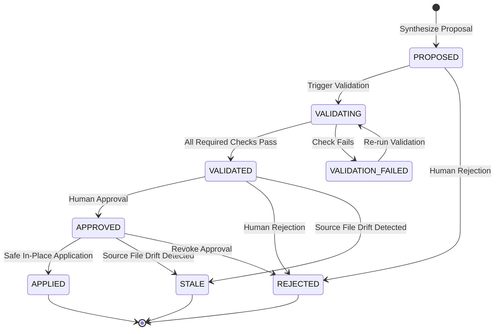
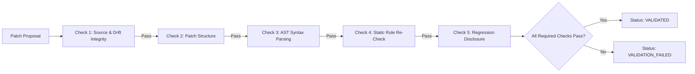

# Phase 7 Architecture: Automated Remediation & Safe Code Patch Synthesis

## 1. Overview & Core Philosophy

**Phase 7** introduces **Automated Remediation & Safe Code Patch Synthesis** to **CodeSentinel AI**, transforming supported, deterministic static analysis findings (Phase 2 & Phase 4) and dependency vulnerabilities (Phase 3) into reviewable, validated patch proposals that require human review and explicit approval before application.

### Non-Negotiable Tenets:
1. **Finding → Strategy → Proposal → In-Memory Validation → Human Review → Explicit Approval → Safe Application**: A patch is not a fix until it has been synthesized against exact source coordinates, validated in memory, reviewed by a developer, explicitly approved, and applied through an atomic write with pre- and post-write SHA-256 verification.
2. **Zero Code Execution**: Target repository source code is never executed, built, imported, or run via test scripts to determine if a patch works. All validations are static AST parsing, delimiter balancing, and deterministic rule re-evaluations.
3. **Decoupled Approval and Application**: Creating a proposal, running validation, approving a proposal, and applying a patch are strictly distinct operations. An unapproved proposal cannot be applied.
4. **Zero Forced External AI Dependencies**: Deterministic AST transformations work out of the box with zero API keys or external network requests.
5. **Snapshot Immutability**: Historical snapshots are read-only point-in-time archives. Patch application is restricted strictly to authorized writable local workspaces within configured `LOCAL_REPOSITORY_ROOTS`. For read-only snapshot archives, the engine falls back to exporting unified diffs without modifying storage.
6. **Strict Anti-Drift & Path Traversal Confinement**: Any drift between the expected target file hash and the actual disk file at application time aborts the operation and marks the proposal `STALE`. Writes to protected paths (`.env`, `.git`, `.ssh`, `.pem`, `id_rsa`) or path traversals (`../`) are blocked at both proposal and application time.

---

## 2. Proposal Lifecycle & State Transitions

Patch proposals follow an explicit, centrally enforced lifecycle:

### Legal Transitions:
- `PROPOSED` $\to$ `VALIDATING`, `REJECTED`, `STALE`
- `VALIDATING` $\to$ `VALIDATED`, `VALIDATION_FAILED`, `STALE`
- `VALIDATION_FAILED` $\to$ `VALIDATING`, `REJECTED`, `STALE`
- `VALIDATED` $\to$ `APPROVED`, `REJECTED`, `VALIDATING`, `STALE`
- `APPROVED` $\to$ `APPLIED`, `REJECTED`, `STALE`, `VALIDATING`
- `REJECTED` $\to$ Final state (no further transitions permitted)
- `APPLIED` $\to$ Final state (idempotent, re-application blocked)
- `STALE` $\to$ Terminal state (requires synthesizing a new proposal against fresh source)

---

## 3. Remediation Rule Catalog

Remediation strategies are implemented as modular subclasses of `BaseRemediationRule` registered in `RemediationRuleRegistry`. Each rule clearly defines its preconditions, transformation strategy, risk classification, confidence policy, and explicit limitations.

| Rule ID | Finding Rule | Target Pattern | Transformation Strategy | Risk | Confidence |
| :--- | :--- | :--- | :--- | :--- | :--- |
| `FIX-PYSEC001-LITERAL-EVAL` | `PYSEC001` | `eval(...)` | Replaces single-argument `eval` with `ast.literal_eval`. Rejects `exec` and expressions using custom scopes or globals. | LOW | HIGH |
| `FIX-PYSEC005-RESTORE-TLS` | `PYSEC005` | `verify=False` / `_create_unverified_context` | Replaces `verify=False` with `verify=True`, or restores `ssl.create_default_context()`. Rejects ambiguous custom context factories. | LOW | HIGH |
| `FIX-PYSEC004-HASH-SHA256` | `PYSEC004` | `hashlib.md5(...)` / `hashlib.sha1(...)` | Replaces weak digest algorithms with `hashlib.sha256(...)` when used for cryptographic signatures or password hashing. | MEDIUM | HIGH |
| `FIX-PYSEC004-NONSEC-FLAG` | `PYSEC004` | `hashlib.md5(...)` in Python 3.9+ | Preserves MD5/SHA-1 for non-security checksums by appending `usedforsecurity=False`. | LOW | HIGH |
| `FIX-PYSEC003-ARG-LIST` | `PYSEC003` | `subprocess.Popen(..., shell=True)` | Splits simple command strings without shell operators into list format and sets `shell=False`. Rejects pipelines (`\|`), redirects (`>`), and compound operators (`&&`, `;`). | MEDIUM | HIGH |
| `FIX-JSSEC001-JSON-PARSE` | `JSSEC001` | `eval(jsonStr)` | Replaces `eval(...)` with `JSON.parse(...)` when the surrounding context indicates JSON parsing. Rejects arbitrary dynamic code evaluation. | LOW | HIGH |
| `FIX-JSSEC002-TEXT-CONTENT` | `JSSEC002` | `elem.innerHTML = str` | Replaces `innerHTML` with `textContent` when plain text is being assigned. Returns `MANUAL_REMEDIATION_REQUIRED` for rich HTML markup. | LOW | HIGH |
| `FIX-DEP-UPGRADE-VERSION` | `VULN-*` | Vulnerable dependency in `requirements.txt` / `package.json` | Updates pinned version to the authoritative remediation version specified in advisory records. | LOW | HIGH |

### Intentionally Unsupported Cases (`MANUAL_REMEDIATION_REQUIRED`):
- `exec()` dynamic execution: Executing arbitrary Python statements cannot be replaced with `ast.literal_eval`.
- Complex shell commands with pipes, variable substitution, or redirection: Converting arbitrary shell scripts to argument lists is undecidable without knowing the shell runtime environment.
- Arbitrary `innerHTML` sinks containing HTML elements: Replacing with `textContent` breaks legitimate web UI rendering.
- Dependencies without an authoritative fixed version in advisory records: Inventing a version is prohibited.
- Unpinned version specifiers (`>=1.0.0`) in manifest files without lockfile context.

---

## 4. Deterministic Patch Engine

The Patch Engine (`backend/app/services/remediation/patch_engine.py`) operates purely on text buffers and enforces 18 strict safety invariants:

1. **SHA-256 Anchoring**: Computes `sha256(source_content)` before and after transformation.
2. **Exact Target Boundary Replacement**: Locates target source lines using 1-indexed boundaries. Checks exact character matching and leading whitespace indentation.
3. **Ambiguity Prevention**: Rejects replacement if the target pattern appears multiple times ambiguously in the line range.
4. **Deterministic Unified Diff Synthesis**: Generates standard unified diff format (`--- a/...`, `+++ b/...`, `@@ -start,len +start,len @@`) with 3 lines of surrounding context.
5. **Path Traversal & Protected Path Rejection**: Blocks paths containing `..`, absolute paths (`/etc`, `C:\Windows`), and sensitive files (`.env`, `.git`, `.ssh`, `id_rsa`, `*.pem`).
6. **Binary & Size Bounds**: Rejects files with null bytes (`\x00`), files exceeding 5 MB, or patches spanning over 1000 lines.
7. **Line Ending Preservation**: Detects `\r\n` vs `\n` and preserves original source newline conventions.

---

## 5. In-Memory Patch Validation Pipeline

The validation pipeline (`backend/app/services/remediation/validator.py`) constructs a temporary in-memory representation of the patched source without touching disk or executing code:

- **Check 1 (`source_integrity`)**: Validates that original file hash matches current source and target path is within authorized boundaries.
- **Check 2 (`patch_structure`)**: Reconstitutes patched content in memory, verifies boundary offsets, and validates diff format.
- **Check 3 (`syntax_validation`)**: Parses patched Python files using `ast.parse` and JSON manifests via `json.loads`. Validates syntax without importing or executing the module.
- **Check 4 (`transformation_validation`)**: Re-runs the deterministic Phase 4 AST static security rules (`PyDynamicCodeRule`, `PyWeakHashRule`, `PyTlsVerifyDisabledRule`, `PyShellExecutionRule`) on the patched AST to verify that the vulnerability is eliminated.
- **Check 5 (`regression_risk`)**: Discloses semantic limitations, noting that syntax validation and static re-checks do not replace full functional test execution.

---

## 6. Safe Patch Application

Applying an approved patch (`backend/app/services/remediation/applier.py`) requires meeting strict safety gates:
1. **Approval Gate**: Proposal must be in `APPROVED` status.
2. **Workspace Containment**: Target repository must have a configured local workspace inside `LOCAL_REPOSITORY_ROOTS`.
3. **Pre-Write Anti-Drift Verification**: Re-reads the physical disk file immediately before writing and verifies its SHA-256 hash against `original_source_hash`. If the file was modified concurrently, application aborts and proposal transitions to `STALE`.
4. **Atomic Write**: Writes replacement content to a temporary sibling file (`.filename.tmp_pid`) and renames it atomically via `os.replace`.
5. **Post-Write Hash Verification**: Re-reads the updated file from disk and confirms its SHA-256 hash matches `target_source_hash`. If mismatch occurs, rolls back to original content.
6. **Audit Event Logging**: Records an immutable audit entry with timestamp, user identity, and pre/post hashes without logging sensitive code contents or secrets.
7. **Idempotency**: Applying an already applied proposal returns `ALREADY_APPLIED` without repeating disk writes.

---

## 7. REST API Reference

| Method | Endpoint | Description |
| :--- | :--- | :--- |
| `GET` | `/api/v1/remediation/rules` | Lists all registered remediation rules and supported finding types |
| `GET` | `/api/v1/remediation/findings/{finding_id}/availability` | Evaluates whether automated remediation is supported for a finding |
| `POST` | `/api/v1/remediation/proposals` | Synthesizes a new patch proposal and executes in-memory validation |
| `GET` | `/api/v1/remediation/proposals` | Lists patch proposals with filtering by repository, snapshot, and status |
| `GET` | `/api/v1/remediation/proposals/{id}` | Retrieves proposal details, unified diff, validation checklist, and audit logs |
| `POST` | `/api/v1/remediation/proposals/{id}/validate` | Re-runs in-memory validation pipeline against current source |
| `POST` | `/api/v1/remediation/proposals/{id}/approve` | Explicitly approves a validated proposal (requires `VALIDATED` status) |
| `POST` | `/api/v1/remediation/proposals/{id}/reject` | Rejects a proposal with a required justification reason |
| `POST` | `/api/v1/remediation/proposals/{id}/apply` | Safely applies an approved patch to the local workspace with anti-drift checks |
| `GET` | `/api/v1/remediation/proposals/{id}/history` | Retrieves complete audit history and state transition log |

---

## 8. Verification & Test Telemetry

- **Backend Pytest Suite**: 216 passed, 3 skipped (PostgreSQL daemon tests), 0 failed across 36 new Phase 7 tests.
- **Frontend Vitest Suite**: 53 passed, 0 failed across 15 test files (including `RemediationPage.test.tsx`).
- **Build & Lint**: `tsc -b && vite build` succeeded in 17.20s with 0 errors; `npm run lint` reported 0 errors.
