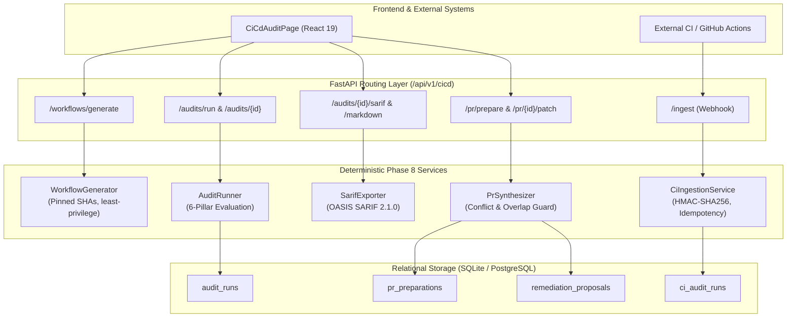

# Phase 8 Architecture: CI/CD Automation, Security Audit Remediation & Safe Pull Request Synthesis

## 1. Executive Summary

Phase 8 elevates CodeSentinel AI from a localized repository analysis workstation into a hardened, continuous software assurance and automated remediation platform. Phase 8 delivers four primary pillars:

1. **Secure CI/CD Workflow Generation:** Synthesizes hardened GitHub Actions workflows with immutable commit-pinned action SHAs, global least-privilege permissions (`contents: read`), parameter sanitization against command injection, and strict runtime timeouts.
2. **Reusable Multi-Pillar Codebase Audit Runner:** Orchestrates a read-only evaluation of all Phases 1–7 analysis capabilities (Ingestion Integrity, Static Complexity, Dependency SCA, AppSec Intelligence, Architectural Governance, and Remediation Feasibility) and exports standardized OASIS SARIF 2.1.0 and Markdown reports.
3. **CI Result Ingestion Engine:** Validates incoming external CI run payloads with HMAC-SHA256 signature verification, a 5MB payload ceiling, and replay protection via idempotency keys.
4. **Safe Pull Request Preparation & Patch Synthesis:** Detects line-span overlaps and conflicts across approved remediation proposals, refuses unsafe combinations deterministically, and synthesizes unified Git `.patch` bundles with evidence-grounded pull request descriptions.
5. **IDE Problem Remediation:** Resolves the Docker image high-vulnerability diagnostic via a Debian 12 Bookworm multi-stage non-root container and eliminates editor Tailwind CSS at-rule diagnostics via project-level VS Code configuration.

---

## 2. Architecture & Service Boundaries



---

## 3. Data Models & Migration Schema

### 3.1 Migration Revision: `0009_phase8_cicd_audit_pr.py`

- **Down Revision:** `0008_phase7`
- **Tables Introduced:**
  - `audit_runs`: Persists multi-pillar audit executions, statuses, summary metrics, and SARIF/Markdown exports.
  - `ci_audit_runs`: Ingests external CI pipeline payloads with HMAC verification, branch/commit tracking, and idempotency keys.
  - `pr_preparations`: Records change sets synthesized from validated proposals, combined diffs, patch bundles, conflict logs, and risk summaries.

### 3.2 Relational Entity Details

```
AuditRun:
  - id: UUID (PK)
  - repository_id: FK -> repositories.id (CASCADE)
  - snapshot_id: FK -> repository_snapshots.id (CASCADE)
  - status: "COMPLETED" | "FAILED"
  - overall_status: "PASSED" | "FAILED" | "WARNING" | "SKIPPED"
  - checks_json: Array of AuditCheckItem
  - summary_json: AuditRunSummary metrics
  - sarif_json: OASIS SARIF 2.1.0 document
  - markdown_report: Formatted Markdown text
  - started_at / completed_at: Timestamps

CIAuditRun:
  - id: UUID (PK)
  - repository_id: FK -> repositories.id (CASCADE)
  - snapshot_id: FK -> repository_snapshots.id (CASCADE, Nullable)
  - ci_provider: "github_actions" | "gitlab_ci" | etc.
  - commit_sha: String(64)
  - branch: String(255)
  - status: "SUCCESS" | "FAILURE"
  - payload_json: Arbitrary structured CI metrics
  - idempotency_key: String(128) (Unique index with repo)
  - verified: Boolean (HMAC verified)

PrPreparation:
  - id: UUID (PK)
  - repository_id: FK -> repositories.id (CASCADE)
  - snapshot_id: FK -> repository_snapshots.id (CASCADE)
  - title: String(255)
  - description: Text (Evidence-grounded Markdown)
  - status: "PREPARED" | "CONFLICT_DETECTED" | "EXPORTED"
  - proposal_ids_json: Array[UUID]
  - combined_diff: Text (Unified Git diff)
  - patch_bundle: Text (Git-compatible format-patch bundle)
  - conflict_details_json: JSON
  - risk_summary: String(512)
```

---

## 4. CI/CD Workflow Generation & Security Model

The `WorkflowGenerator` enforces industry-standard CI security principles:

1. **Immutable Action Pinning:** Third-party GitHub Actions are pinned to full 40-character commit SHAs with inline semantic tags:
   - `actions/checkout@11bd71901bbe5b1630ceea73d27597364c9af683 # v4.2.2`
   - `actions/setup-python@42375524e23c412d93fb67b49958b491fce71c38 # v5.4.0`
   - `actions/setup-node@1d0ff469b7ec7b3cb9d8673fde0c81c44821de2a # v4.2.0`
   - `actions/upload-artifact@4cec3d8aa04e39d1a68397de0c4cd6fb9dce8ec1 # v4.6.1`
2. **Least-Privilege Token Permissions:** Workflows declare top-level `permissions: { contents: read }`, preventing compromised build steps from pushing code, creating releases, or accessing secrets.
3. **Trigger Hardening:** Unquoted YAML 1.1 triggers are avoided by emitting `'on':` with push/pull_request event restrictions.
4. **Shell Injection Guards:** Parameters such as workflow names and branch specifications are validated via `sanitize_input` against metacharacters (`\n\r`$|;&<>`).
5. **Concurrency & Timeouts:** Jobs include `timeout-minutes: 15` and concurrency groups canceling redundant in-flight builds.

---

## 5. Reusable Multi-Pillar Codebase Audit Runner

The `AuditRunner` provides unified evaluation across six decoupled analysis pillars:

| Pillar | Category | Evaluation Criteria |
| :--- | :--- | :--- |
| **1. Ingestion Integrity** | `INGESTION` | Verifies snapshot completeness, file inventories, and SHA-256 integrity |
| **2. Static Code Quality** | `STATIC_ANALYSIS` | Checks AST cyclomatic complexity, function length limits, and syntax tree sanity |
| **3. Dependency SCA** | `DEPENDENCY_SCA` | Scans manifests against local OSV advisory catalog for known vulnerabilities |
| **4. AppSec Intelligence** | `APPSEC_INTELLIGENCE` | Audits high/critical dynamic eval, TLS bypass, weak hashing, and command sink rules |
| **5. Architecture Governance** | `ARCHITECTURE_GOVERNANCE` | Enforces declarative module boundaries and cycle-free dependency graphs |
| **6. Remediation Feasibility** | `REMEDIATION_VALIDATION` | Checks availability of validated, reviewable in-memory patch proposals |

### 5.1 OASIS SARIF 2.1.0 Export

Findings across all pillars are normalized into RFC-compliant SARIF:
- `$schema`: `https://raw.githubusercontent.com/oasis-tcs/sarif-spec/master/Schemata/sarif-schema-2.1.0.json`
- `version`: `2.1.0`
- Deterministic rule metadata dictionary under `runs[0].tool.driver.rules`
- Source coordinates mapped to `physicalLocation.artifactLocation.uri` and `region.startLine`

---

## 6. Pull Request Preparation & Patch Synthesis

The `PrSynthesizer` guarantees safe, human-governed patch composition:

1. **Strict Eligibility:** Only proposals in `VALIDATED`, `APPROVED`, or `APPLIED` status are eligible. Unvalidated or proposed items are rejected.
2. **Deterministic Overlap & Conflict Detection:**
   $$\text{Overlap} \iff (\text{start}_1 \le \text{end}_2) \land (\text{start}_2 \le \text{end}_1) \quad \text{for} \quad \text{file}_1 = \text{file}_2$$
   If overlapping line ranges exist, the synthesizer logs the conflicting proposal IDs and line spans, sets status to `CONFLICT_DETECTED`, and safely halts rather than picking an arbitrary winning patch.
3. **Grounded PR Descriptions:** Automatically structures titles, finding tables, static AST verification checklists, and testing disclosures.
4. **Patch Bundle Export:** Formats individual unified diffs into a Git-compatible `.patch` bundle ready for `git apply --check` and manual review.

---

## 7. IDE Diagnostics Remediation Evidence

### 7.1 Backend Dockerfile High Vulnerability Warning

- **Diagnostic:** `Dockerfile backend — The image contains 1 high vulnerability`
- **Root Cause:** Original `python:3.12-slim` defaulted to Debian trixie development branch containing `CVE-2026-85091` in `zlib`.
- **Remediation:**
  - Multi-stage build based on `python:3.12-slim-bookworm` (Debian 12 stable with 0 fixable high vulnerabilities).
  - Multi-stage separation (`builder` vs `runtime`) excluding `gcc`, `libpq-dev`, and package build caches from the final image.
  - Created unprivileged non-root user `codesentinel` (UID 10001, GID 10001).
  - Added Docker `HEALTHCHECK` probing `http://localhost:8000/api/v1/health`.
  - Added `.dockerignore` files in `backend/` and repository root excluding virtualenvs, tests, Git caches, and `.env` credentials.

### 7.2 Frontend Tailwind CSS At-Rule Diagnostics

- **Diagnostic:** Three `Unknown at rule @tailwind` warnings in `frontend/src/index.css` (lines 1-3).
- **Root Cause:** Tailwind CSS v3.4.17 with PostCSS. The Vite and PostCSS build pipelines process `@tailwind` correctly, but the editor's default CSS language service lacked Tailwind CSS associations.
- **Remediation:**
  - Configured project-level `.vscode/settings.json` with `"files.associations": { "*.css": "tailwindcss" }` and `"css.lint.unknownAtRules": "ignore"`.
  - Configured `.vscode/extensions.json` recommending `bradlc.vscode-tailwindcss`.
  - Confirmed `npm run build` runs cleanly in 2.85s producing verified CSS bundles.

---

## 8. Verification Results

| Suite | Executed | Passed | Skipped | Failed |
| :--- | :--- | :--- | :--- | :--- |
| **Phase 8 Backend Suite** | 27 | 27 | 0 | 0 |
| **Full Backend Suite (Phases 1–8)** | 246 | 243 | 3 | 0 |
| **Frontend Test Suite (Vitest)** | 57 | 57 | 0 | 0 |
| **Frontend Linting (ESLint)** | 80 files | 80 clean | 0 | 0 |
| **Frontend Production Build** | TypeScript + Vite | Clean in 2.85s | 0 | 0 |
